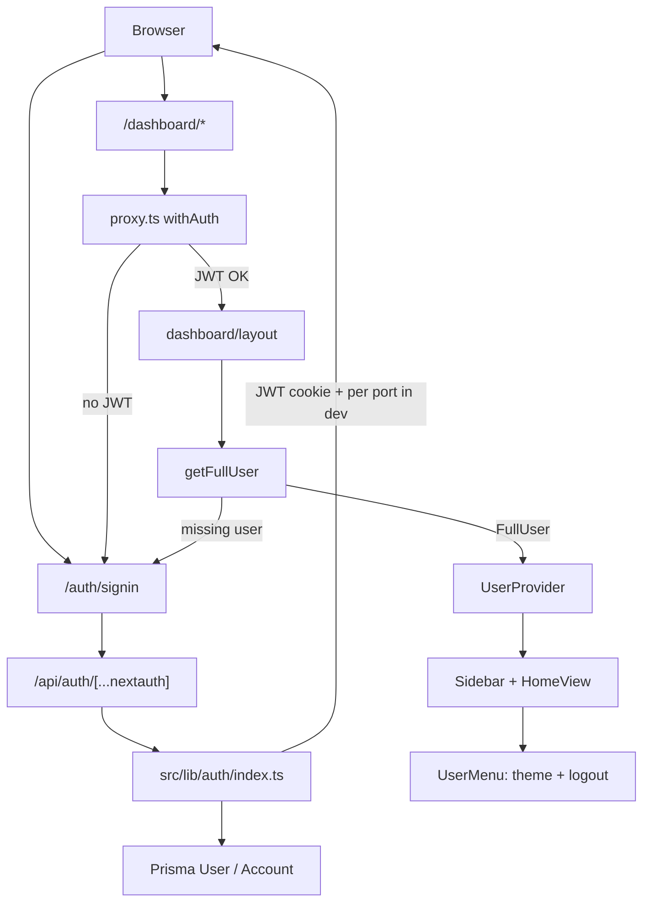

# NextAuth authentication

High-level overview of auth in this template.

## Overview

Invite-only auth with **NextAuth v4**:

- Providers:
  - Google OAuth.
  - Credentials: using email/password.
  - Credentials: for a development-only one-click sign-in.
- JWT sessions (no DB session tables).
- Prisma `User` / `Account` for identity and linked providers.
- Per-port auth cookies in development to allow repo copies stay signed in
  at the same time (see [Repo copies](repo-copies.md)).

No public registration. Users must already exist (usually via seed). Google
only works if that email already has a `User` row.

### Cookie names

| Default                   | Development (e.g. port 3001)   |
| ------------------------- | ------------------------------ |
| `next-auth.session-token` | `next-auth.3001.session-token` |
| `next-auth.csrf-token`    | `next-auth.3001.csrf-token`    |
| `next-auth.callback-url`  | `next-auth.3001.callback-url`  |

## Design choices

| Choice                           | Reason                                                         |
| -------------------------------- | -------------------------------------------------------------- |
| NextAuth v4                      | Stable                                                         |
| JWT                              | Simple sessions without `Session` / `VerificationToken` tables |
| Invite-only                      | Closed access by default                                       |
| `UserProvider` over `useSession` | Server loads the DB user; client gets typed context            |
| Development provider             | Production has no such provider; so nothing can call it        |
| Port in cookie names             | Repo copies on different ports keep separate sessions          |

## Flow

Sign-in goes through `/api/auth/[...nextauth]` (`src/lib/auth/index.ts`) and redirects to the dashboard if successful.

Some relevant details:

- **Dashboard routes:** are protected at the edge (`proxy.ts`) and again in the layout.
- **Credentials:** validate against `User.password` using bcrypt.
- **Development:** sign in as `SEED_USER_EMAIL`.
- **Cookies:** `authOptions` and `proxy.ts` share the cookie names from
  `src/lib/auth/cookies.ts`.
- **Google:** allow only if the user exists, link `Account` if missing,
  otherwise `AccessDenied`.
- **Identity in app code:** use `getUser` / `getFullUser` on the server and
  `useUser()` on the client — not `SessionProvider` / `useSession`.
- **Errors:**
  - Bad credentials stay on the sign-in form.
  - Denied Google and NextAuth failures go to `/error?error=…`.

## Considerations

- **Extending:**
  - Add users via seed data (see `scripts/seed/data/user.ts`)
  - Extend `FullUser` when you need more dashboard context.
  - Widen `proxy.ts` matcher for more private routes.
  - Pass any new auth cookie option to `withAuth` in `proxy.ts` too; it
    doesn't read `authOptions`.
