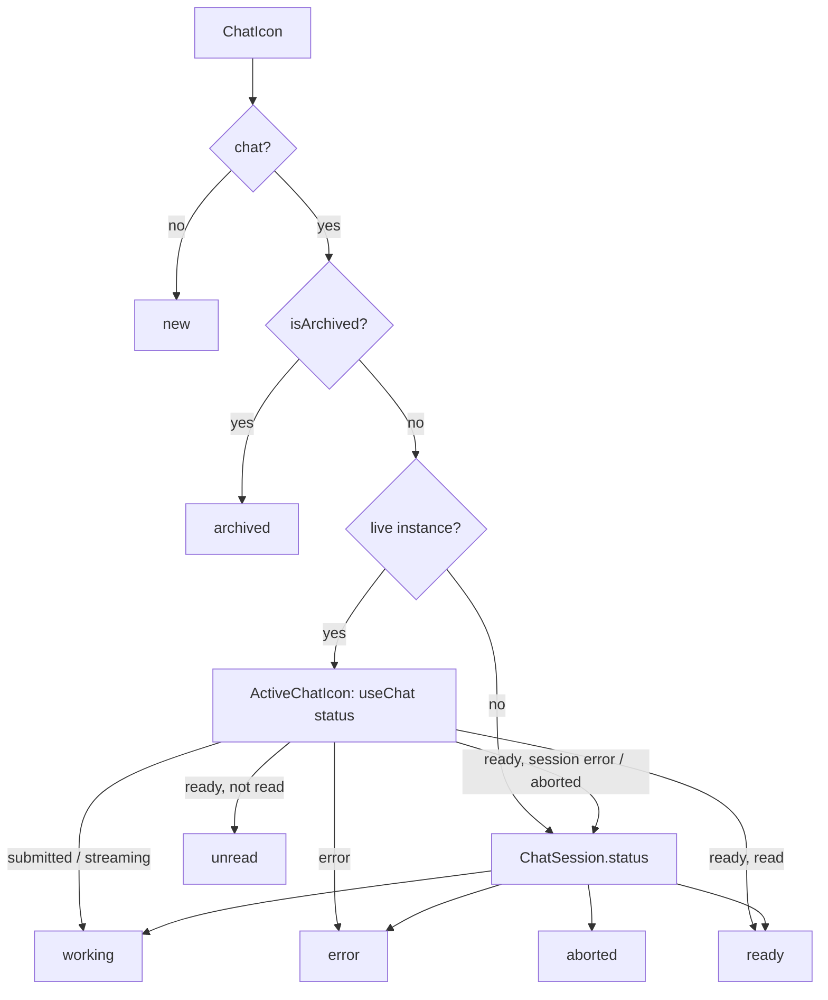

# Chat icon

High-level overview of the chat status icon in this template.

## Overview

`ChatIcon` component to show one colored Lucide icon per chat:

- Status picked from Live AI SDK instance, with the saved `ChatSession.status`
  as fallback.
- `unread` icon for replies that end while the chat is closed.

### Statuses

| Status     | When                                | Icon                       | Color                                  |
| ---------- | ----------------------------------- | -------------------------- | -------------------------------------- |
| `new`      | No `chat`                           | `LucideMessageCirclePlus`  | `text-gray-800 dark:text-neutral-200`  |
| `ready`    | Idle, and the last reply was read   | `LucideMessageCircle`      | `text-gray-800 dark:text-neutral-200`  |
| `unread`   | A reply ended while it was not open | `LucideMessageCircleCheck` | `text-blue-600 dark:text-blue-500`     |
| `working`  | `submitted` or `streaming`          | `LucideCircleDashed`       | `text-indigo-600 dark:text-indigo-500` |
| `error`    | The last reply failed               | `LucideMessageCircleX`     | `text-red-600 dark:text-red-400`       |
| `aborted`  | The user stopped the last reply     | `LucideMessageCircleOff`   | `text-yellow-500 dark:text-yellow-500` |
| `archived` | `chat.isArchived` is true           | `LucideArchive`            | `text-gray-500 dark:text-neutral-400`  |

## Design choices

| Choice                            | Reason                                                  |
| --------------------------------- | ------------------------------------------------------- |
| Live status first                 | The session row is only updated when a reply ends       |
| Session wins on `error`/`aborted` | A live chat goes back to `ready`, which would hide them |
| Unread ids in `useChatSessions`   | All icons of a chat show the same read state            |

## Flow

`ChatIcon` looks up the chat's live instance in `useChatInstances`. With
no instance, the saved `ChatSession.status` picks the icon. Otherwise,
`ActiveChatIcon` follows the instance with `useChat` and tracks if the
last reply was read.

Some relevant details:

- **Instances:** `src/hooks/use-chat-instances.tsx` exposes `instances`
  through `useSyncExternalStore`, so the icon re-renders when one is
  created or deleted.
- **Aborted:** the AI SDK has no `aborted` status and `stop()` returns to
  `ready`, so the session status wins over a live `ready`.
- **Read state:** `useChatSessions` keeps the unread chat ids. An effect in
  `ChatIcon.tsx` updates them:
  - `setIsRead(id, false)` when a closed chat starts working.
  - `setIsRead(id, true)` once the chat is open.
- **Open chat:** `useChatSession` > `isOpen(id)` matches the chat page; or, the
  visible chat sidebar, tracked with `useOverlayEvents`.

## Considerations

- **Extending:**
  - **Adding a status:** add it to `ChatIconStatus`, return it from
    `getChatIconStatus`, and add its entry to `ICONS` in `ChatIcon.tsx`.
