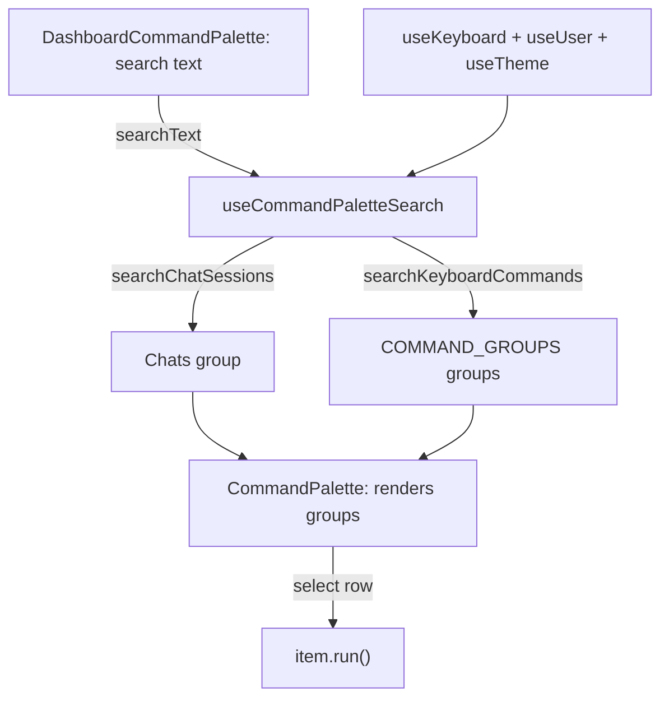

# Command palette

High-level overview of the dashboard `⌘K` palette: it searches commands and
chats.
For chords and the command registry, see
[keyboard-shortcuts.md](keyboard-shortcuts.md).

## Overview

A `cmdk` palette inside the existing Preline `Modal` overlay:

- `⌘K` / `Ctrl+K` toggles the command palette (always active, including
  inside inputs).
- `/` opens the palette when focus is not in an editable field.
- `Chats` comes first, then one group per `COMMAND_GROUPS` entry.
- The arrow keys wrap from the last row to the first and back.

## Design choices

| Choice                   | Reason                                             |
| ------------------------ | -------------------------------------------------- |
| Preline `Modal`          | Reuses existing overlay stack and z-index behavior |
| Generic `CommandPalette` | Shared UI renders groups; the app owns the search  |
| Client-side chat search  | Every chat is already in `useUser()`; no backend   |

## Flow

`DashboardCommandPalette` holds the search text and passes
`shouldFilter={false}`, so cmdk shows the groups exactly as the hook builds
them.

Some relevant details:

- **Unique `value`:** cmdk uses each row's `value` to identify it. If two rows
  share one, both look selected and the arrow keys can't move between them.
- **Search:** `useCommandPaletteSearch` handles the search and builds the
  groups:
  - **Chats:**
    - An empty search shows only active chats from the last 7 days.
    - While typing, chats are matched against `title` and the `Chats` group
      name. Sorted by `isArchived` (active before archived), then by
      `lastMessageAt` (newest first).
    - The group shows 7 rows, plus a "Show N more" row when there are more.
  - **Keyboard commands:** filtered using cmdk's `defaultFilter` on `label`,
    `keywords`, and `group`.

## Considerations

- **Extending:** new groups should be built in `useCommandPaletteSearch`;
  `CommandPalette` needs no change.
