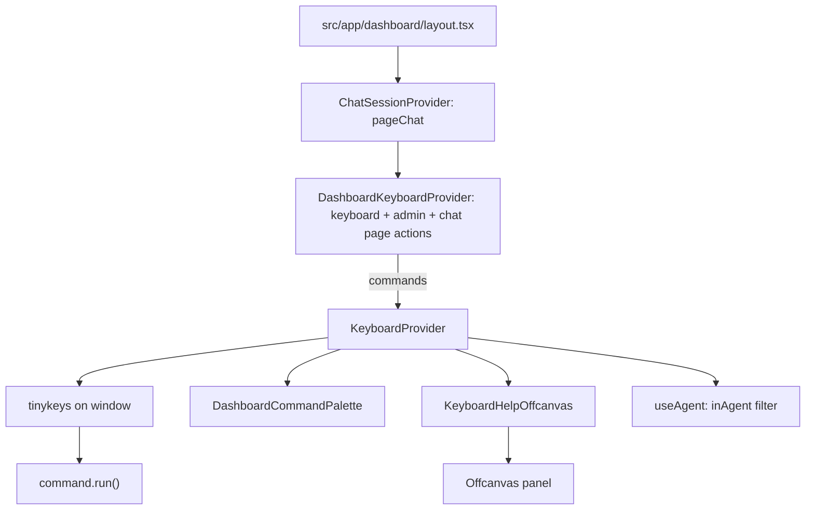

# Keyboard shortcuts

High-level overview of dashboard keyboard shortcuts and the keyboard
shortcuts help panel.
For the `⌘K` palette, see [command-palette.md](command-palette.md).

## Overview

Dashboard-only shortcuts powered by `tinykeys`, plus a keyboard shortcuts
help panel in a Preline `Offcanvas`:

- Global chords bind on `window` via `KeyboardProvider`.
- `⌘/` / `Ctrl+/` opens the keyboard shortcuts help panel.

## Design choices

| Choice              | Reason                                             |
| ------------------- | -------------------------------------------------- |
| `tinykeys` + `$mod` | Cross-platform ⌘ / Ctrl without custom key parsing |

## Bindings

| Chord                  | Action                                   |
| ---------------------- | ---------------------------------------- |
| `⌘K` / `Ctrl+K`        | Toggle command palette                   |
| `/`                    | Open palette (non-editable targets only) |
| `⌘⇧,` / `Ctrl+Shift+,` | Toggle resolved light / dark theme       |
| `⌘B` / `Ctrl+B`        | Toggle sidebar overlay                   |
| `⌘⇧O` / `Ctrl+Shift+O` | New chat                                 |
| `⌘J` / `Ctrl+J`        | Toggle chat sidebar                      |
| `⌘⇧.` / `Ctrl+Shift+.` | Confetti                                 |
| `⌘⇧/` / `Ctrl+Shift+/` | Open flag toolbar (admin)                |
| `⌘/` / `Ctrl+/`        | Open keyboard shortcuts help panel       |

Only `⌘K`, `⌘⇧O` (new chat), and `⌘J` run inside editable targets; other
chords and `/` do not.
Esc closes the palette and help panel via Preline (not `tinykeys`).
Shortcut labels show Mac or Windows, not both, via `getIsMac`.

## Flow

`DashboardKeyboardProvider` (app layer) builds the dashboard actions and
renders the generic `KeyboardProvider` (shared) with the resulting
`commands`. `KeyboardProvider` binds the chords and shares the commands with
palette rows and the agent. The layout renders `DashboardCommandPalette` and
`KeyboardHelpOffcanvas` inside it.

Some relevant details:

- **Registry:**
  - `src/components/keyboard/config.tsx` lists ids, labels, groups,
  optional chords, keywords, and optional palette `icon` nodes.
  - Chord-only commands skip the palette via `inPalette: false`.
  - Commands with `inEditable: true` also run inside editable targets.
  - Commands with `inAgent: false` are hidden from the agent context.
- **Groups:** `COMMAND_GROUPS` sets the group order for both the help panel
  and the palette.
- **Help panel:** `KeyboardHelpOffcanvas` lists the commands that have a chord,
  by group, with a case-insensitive search on label, group, and keywords.

## Considerations

- **Scope:** Shortcuts are dashboard-only; marketing and auth pages are
  unchanged.
- **Preline vs cmdk:** Arrow keys and typing stay on cmdk while the palette
  is open; other chords pause except `⌘K` / `Ctrl+K`.
