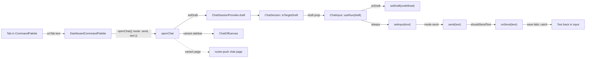

# RNT-44 · Trigger chat from the command palette

## Context

Keyboard power users search in ⌘K and then have to retype the same text
into the chat. RNT-44 makes it a single keystroke: with text in the palette,
**Tab** starts a **new** sidebar chat with that text and sends it. Search,
arrows and Enter behave exactly as they do today.

Decisions from the refine session and the review:

- Tab with an empty search does nothing.
- The text always goes to a new chat in the sidebar.
- The palette closes after Tab and keeps its search text.
- The input shows an "Ask chat · Tab" hint, dimmed while the search is
  empty. `DashboardCommandPalette` builds it (`TabKbd`) and passes it
  through the generic `searchSuffixes` prop of `CommandPalette`.
- The handoff uses a `ChatDraft` in `ChatSessionProvider`:
  - `variant` + `id` decide which `ChatSection` picks it up.
  - `mode` (`DraftMode`) decides whether that chat sends the text or only
    prefills its input.
  - Prefill isn't used yet; it's for RNT-52's fork.
- `openChat({ id?, variant?, mode?, text? })` (a `Partial<ChatDraft>`)
  replaces `openChat(id?)`. Passing `text` also sets the draft, and `mode`
  defaults to `"prefill"`. It routes by `variant`:
  - `"sidebar"` (the default) opens the side panel.
  - `"page"` navigates to the chat page.
  - This takes over the `open()` helper planned in
    `docs/plans/rnt-52-add-edit-retry-fork-actions.md`. That doc stays as
    it is for now.
- **The draft is passed down as data, not as a `defaultValue`.**
  `ChatSection` passes the matching `ChatDraft` to `ChatInput` as a prop,
  and `ChatInput` watches it with an effect.
  - It works when the target chat is already mounted, so there's no forced
    remount. This keeps the chat's UI state and leaves room for opening an
    active chat with a prompt later.
  - There is no ref and no `useImperativeHandle`.
- **`send(text)` only sends.** It checks `shouldSendText` itself and never
  looks at `mode`. The draft handler checks `mode` before calling it:
  - It always prefills (`setInput(text)`).
  - With `mode === "send"` it then calls `send(text)`.
  - If the text can't be sent yet, it stays in the input.
- **`shouldSendText({ text, isWorking, disabled })` is the single send
  rule:** non-empty text, the chat isn't working, and the input isn't
  disabled. It's a module-level function in `ChatInput.tsx`. The component's
  `shouldSend` (the send button's disabled state) uses it too.
- A failed save puts the text back in the sidebar input. This reuses the
  restore path `ChatInput` already has.
- A shared `useRun(params, callback)` hook handles each draft object once.
  Strict Mode, Fast Refresh and `<Activity>` re-run effects with the same
  object, and those runs are skipped.
- Out of scope: accessibility hints, an "Ask agent" palette row, sending
  page context, React component tests, and updating the RNT-52 plan doc.

Branch: `brandon-cercedo/rnt-44-trigger-chat-from-commandpalette` (off
`main`).

## Flow



## Changes

### 1. Draft + routing: `src/features/chat/hooks/use-chat-session.tsx`

```tsx
export type ChatVariant = "page" | "sidebar";

export type DraftMode = "send" | "prefill";

export type ChatDraft = {
  id?: string; // undefined = a new, unsaved chat
  variant: ChatVariant;
  mode: DraftMode; // What the target chat does with `text`
  text: string;
};

type ChatSessionContextType = {
  // ...existing fields
  openChat: (options?: Partial<ChatDraft>) => void;

  // Draft chat (command palette)
  draft?: ChatDraft;
  setDraft: (draft?: ChatDraft) => void;
};

// ChatSessionProvider
const [draft, setDraft] = useState<ChatDraft>();

/**
 * Opens a chat in the sidebar (default) or the chat page.
 *
 * @note With `text`, it also sets the draft for the target chat.
 */
const openChat = ({
  id,
  variant = "sidebar",
  mode = "prefill",
  text,
}: Partial<ChatDraft> = {}) => {
  if (text) {
    setDraft({ id, variant, mode, text });
  }

  if (variant === "page") {
    router.push(id ? paths.dashboard.chat(id) : paths.dashboard.chats());
    return;
  }

  // ...existing sidebar logic, unchanged: setChatId/setKey, open overlay,
  // redirect when `id` is the chat page's chat
};
// value={{ ...existing, draft, setDraft }}
```

With `mode` defaulting to `"prefill"`, a caller that passes only `text`
never sends by accident. The palette passes `mode: "send"` explicitly.

The existing callers move to the object form. The sidebar is the default,
so they behave the same:

- `src/app/dashboard/_components/keyboard/hooks/use-dashboard-keyboard.tsx`:
  `openChat({ id: pageChat.id })`
- `src/features/chat/components/buttons/ChatOpenOffcanvasButton.tsx`:
  `openChat({ id: chat?.id })`

### 2. Matching the draft: `src/features/chat/utils.ts`

This is a pure boolean check, so it can be tested without rendering. The
caller picks the draft or `undefined`.

```ts
/**
 * Checks if the draft targets this chat (same variant and chat id).
 */
export function isTargetDraft({
  draft,
  chatId,
  variant,
}: {
  draft?: ChatDraft;
  chatId?: string;
  variant: ChatVariant;
}) {
  return draft?.variant === variant && draft.id === chatId;
}
```

`ChatDraft` and `ChatVariant` are type-only imports from
`@/features/chat/hooks/use-chat-session`.

### 3. Wiring: `src/features/chat/components/ChatSection.tsx`

```tsx
import {
  ChatVariant,
  useChatSession,
} from "@/features/chat/hooks/use-chat-session";
import { isTargetDraft /* , ...existing */ } from "@/features/chat/utils";

// `ChatSectionVariant` is replaced by `ChatVariant`
type ChatSectionProps = { variant?: ChatVariant /* , ...existing */ };

// inside ChatSection (chatId = chat?.id already exists)
const { draft, setDraft } = useChatSession();
const isValidDraft = isTargetDraft({ draft, chatId, variant });

// <ChatInput
//   draft={isValidDraft ? draft : undefined}
//   onDraft={() => setDraft(undefined)}
//   status={status}
//   ...existing props
// />
```

`VARIANT_STYLES` is typed as `Record<ChatVariant, VariantStyles>`.

### 4. Acting on the draft: `src/features/chat/components/ChatInput.tsx`

- `shouldSendText({ text, isWorking, disabled })` is a module-level
  function in the same file, and the one send rule. Its argument is an
  object because the project allows at most 2 function arguments.
  `shouldSend` uses it with `input` for the send button.
- The body of `handleSend` moves into `send(text)`, which only sends:
  - It returns early unless `shouldSendText` passes for the given text.
  - Otherwise it behaves as today: clear the input, call `onSend`, and
    restore the text if the save fails.
  - It checks the text it's given, not `input`, because a draft's text
    isn't in `input` until the next render.
- Form submit and Enter call `send(input)`.
- The `draft` prop is the full `ChatDraft` (no `Pick` type).
- `useRun(draft, handleDraft)` handles the `draft` prop once:
  - It calls `onDraft()`, and the parent clears the draft.
  - It always prefills with `setInput(text)`.
  - `if (mode === "send")` it calls `send(text)`. This one skips the
    early-return rule on purpose: prefill always runs, and send is the
    optional extra step.
  - When the text can't be sent yet, the prefill keeps it in the input.
- `handleDraft` is a plain function. `useRun` wraps it in
  `useEffectEvent`, and React doesn't allow passing an effect event to
  another hook.
- Two drafts with the same text are different objects, so both are
  handled.

```tsx
import { ChatDraft } from "@/features/chat/hooks/use-chat-session";
import { useRun } from "@/hooks/use-run";

// Module level, next to getIsExpanded
function shouldSendText({
  text,
  isWorking,
  disabled,
}: {
  text: string;
  isWorking: boolean;
  disabled: boolean;
}) {
  return text.trim().length > 0 && !isWorking && !disabled;
}

type ChatInputProps = {
  draft?: ChatDraft;
  onDraft?: () => void; // Called once a draft is taken
  // ...existing props
};

/**
 * @note To only prefill the input, use `draft` in `prefill` mode instead of a
 * `defaultValue` prop:
 * - It could reach an already mounted input without a remount, so the
 *   chat's UI state is kept (e.g. an open sidebar chat).
 */
export default function ChatInput(/* ... */) {}

// inside ChatInput (isWorking already exists)
const shouldSend = shouldSendText({ text: input, isWorking, disabled });

const send = async (value: string) => {
  const shouldSend = shouldSendText({ text: value, isWorking, disabled });
  if (!shouldSend) {
    return;
  }

  const text = value.trim();
  const prevIsExpanded = isExpanded;

  setInput("");
  setIsExpanded(false);
  try {
    await onSend(text);
  } catch {
    setInput(text);
    setIsExpanded(prevIsExpanded);
  }
};

const handleDraft = (draft: ChatDraft) => {
  onDraft?.();

  if (["prefill", "send"].includes(draft.mode)) {
    setInput(draft.text);
  }
  if (draft.mode === "send") {
    void send(draft.text);
  }
};

useRun(draft, handleDraft);

const handleSend = () => send(input);
// form onSubmit and textarea Enter keep calling handleSend()
```

Notes:

- `shouldSend` inside `send` shadows the component's `shouldSend`, which is
  for `input`. The ESLint config has no `no-shadow` rule, so lint passes.
- The existing `ResizeObserver` recalculates `isExpanded` after a prefill
  or a restore changes the text height.
- `ChatInput` stays under 300 lines; it's about 164 today.

### 5. Run once per object: `src/hooks/use-run.ts`

A shared hook, so other features can reuse the guard.

```ts
/**
 * Runs `callback` once for each new `params` object.
 *
 * @note Strict Mode runs effects twice in development. The ref remembers the
 * last `params`, so the second run with the same object is skipped.
 *
 * @note Use it for one-time side effects driven by a prop or state object,
 * like sending a message or creating a record. Pass a new object to run it
 * again; equal values in a new object still run.
 */
export function useRun<T>(
  params: T | undefined,
  callback: (params: T) => void
) {
  const paramsRef = useRef<T>(undefined);
  const handleRun = useEffectEvent(callback);

  useEffect(() => {
    if (!params || paramsRef.current === params) {
      return;
    }

    paramsRef.current = params;
    handleRun(params);
  }, [params]);
}
```

In production, `[params]` already limits re-runs, but `<Activity>` (hide
and show) re-runs effects too, so the ref still matters there.

### 6. Shared palette: `src/components/keyboard/CommandPalette.tsx`

The file is 250 lines today and stays under 300. It never imports chat;
`onTab` and `searchSuffixes` are generic props. Preline's `handleGlobalKeydown` listens on
`document`, and React's root listener runs first, so `stopPropagation`
keeps Tab away from Preline (the same reason as the existing Enter fix).

```tsx
type CommandPaletteProps = {
  // ...existing props
  searchSuffixes?: React.ReactNode[];
  onTab?: (searchText: string) => void;
};

// Content: add `searchSuffixes` and `onTab` to the props, plus
const { close } = useOverlay();

function handleTab(event: React.KeyboardEvent) {
  if (!onTab || event.shiftKey || event.nativeEvent.isComposing) {
    return;
  }

  event.preventDefault();
  event.stopPropagation();

  const text = searchText?.trim();
  if (!text) {
    return;
  }

  onTab(text);
  void close(OVERLAY_IDS.COMMAND_PALETTE);
}

// <Command onKeyDown>
onKeyDown={(event) => {
  if (event.key === "Tab") {
    handleTab(event);
    return;
  }
  if (event.key !== "Enter") {
    return;
  }
  // Preline HSOverlay onEnter reopens the modal when Enter
  event.stopPropagation();
}}

// right after Command.Input
{searchSuffixes}
```

Pass `searchSuffixes` and `onTab` from `CommandPalette` to `Content`, as
with the other props. A plain array is enough: the parent owns
`searchText`, so no render function is needed.

### 7. App wiring: `src/app/dashboard/_components/command-palette/DashboardCommandPalette.tsx`

```tsx
import KbdList from "@/components/keyboard/Kbd";
import { useChatSession } from "@/features/chat/hooks/use-chat-session";

function TabKbd({ disabled }: { disabled: boolean }) {
  return (
    <div
      className={clsx("flex items-center gap-1", { "opacity-50": disabled })}
    >
      <span className="p-0.5 text-[11px] text-nowrap ...">Ask chat</span>
      <KbdList keys={["Tab"]} size="xs" />
    </div>
  );
}

export default function DashboardCommandPalette() {
  const [searchText, setSearchText] = useState("");
  const { groups } = useCommandPaletteSearch({ searchText });
  const { openChat } = useChatSession();
  const isValidText = Boolean(searchText.trim());

  // Always a new sidebar chat; the search text is kept.
  const handleTab = (text: string) => {
    openChat({ mode: "send", text });
  };

  return (
    <CommandPalette
      groups={groups}
      searchText={searchText}
      shouldFilter={false}
      searchSuffixes={[<TabKbd key="tab" disabled={!isValidText} />]}
      onSearch={setSearchText}
      onTab={handleTab}
    />
  );
}
```

### 8. Docs

- `docs/command-palette.md`: add Tab to the overview bullets, a
  `Tab → onTab` edge to the flow, and a "Search suffixes" detail.
- `docs/chatbot.md`: describe `openChat({ id, variant, mode, text })`,
  `ChatDraft`, `DraftMode`, `isTargetDraft`, the `draft` prop on
  `ChatInput`, and `useRun`, in the flow and the "Input" bullet.

## Tests (hooks and utils only, no React component tests)

`src/features/chat/hooks/__tests__/use-chat-session.test.tsx`: existing
`openChat("chat-1")` calls become `openChat({ id: "chat-1" })`. The file is
near the 300-line limit, so its whole `openChat` block moves to a new file.

`src/features/chat/hooks/__tests__/use-chat-session.open-chat.test.tsx`
(new; same split as `actions.archive.test.ts`): the existing `openChat`
tests, plus:

- `openChat` with no `text` leaves `draft` undefined.
- `openChat({ text })` with no `mode` sets a `"prefill"` draft.
- `variant: "page"` pushes `paths.dashboard.chat(id)` (or
  `paths.dashboard.chats()` with no id). It doesn't open the overlay and
  doesn't change `chatId` or `key`.

```tsx
it("should set a sidebar draft when opening with text", () => {
  const { result } = renderChatSession();

  act(() => {
    result.current.openChat({ mode: "send", text: "hi" });
  });

  expect(result.current.draft).toEqual({
    id: undefined,
    variant: "sidebar",
    mode: "send",
    text: "hi",
  });
  expect(mockOpenOverlay).toHaveBeenCalledWith(OVERLAY_IDS.CHAT_OFFCANVAS);
});
```

`src/features/chat/__tests__/utils.is-target-draft.test.ts` (new; same
naming as `utils.get-chat-icon-status.test.ts`):

```ts
const draft: ChatDraft = { variant: "sidebar", mode: "send", text: "hi" };

describe("isTargetDraft", () => {
  it("should be true when the draft targets the chat", () => {
    expect(isTargetDraft({ draft, variant: "sidebar" })).toBe(true);
  });

  // Same shape for:
  // - "should be false without a draft"
  // - "should be false for another variant"
  // - "should be false for another chat id"
  // - "should be true for a saved chat with the same id"
});
```

`src/hooks/__tests__/use-run.test.ts` (new), rendered with
`reactStrictMode: true`:

- It doesn't run without `params`.
- It runs once in Strict Mode.
- A rerender with the same object doesn't run again.
- A new object with the same values runs again.

`ChatInput`'s draft handling (send, prefill, restore on failure) is covered
by the browser checks below, not by unit tests.

## Verification

1. `pnpm lint`, `pnpm type:check` and `pnpm test`, then `pnpm test:all`
   before the PR.
2. Browser (`pnpm dev`, sign in with DevelopmentSignIn on `/auth/signin`):
   - Open ⌘K with an empty search. The "Ask chat · Tab" hint looks dimmed, and Tab
     does nothing.
   - Type "explain useEffect cleanup", then press Tab. The palette closes,
     the sidebar opens a new chat, and the reply streams. ⌘K again still
     shows the text.
   - Press Tab again with the same text. A second new chat is created
     (two drafts with the same text are both handled).
   - With a saved chat open in the sidebar, Tab starts a **new** chat.
   - On `/dashboard/chats` (new page chat), Tab sends only in the sidebar,
     and the page input stays empty.
   - The existing open-in-sidebar button and the "move chat to sidebar"
     shortcut still work.
   - Arrows, Enter on a row and Shift+Tab behave as they do today.
   - Failed save: make `handleCreateChatSession` fail, for example by
     stopping the DB. The error `Alert` shows and the text is back in the
     sidebar input.
   - Blocked draft: send a first message in a new sidebar chat, then Tab
     from ⌘K while it is still saving. Only one save runs, and the palette
     text stays in the input.
   - Check in dev (Strict Mode) that only one chat is created per Tab.
