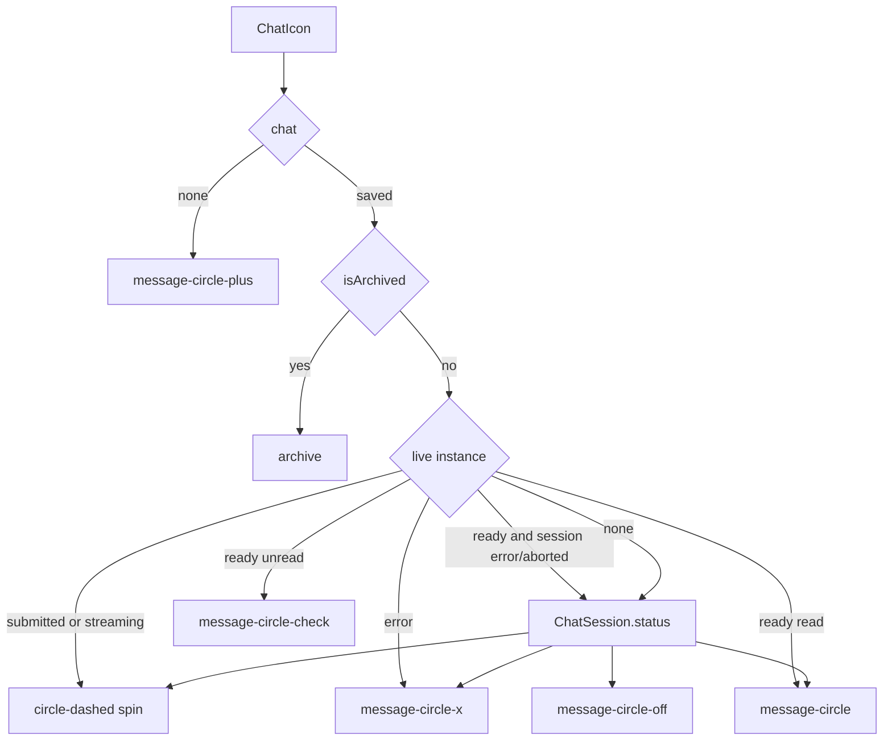

# RNT-81: Show colored icons based on chat status

Add a `ChatIcon` that picks a colored Lucide icon from the live AI SDK
chat status, falling back to the saved `ChatSession`, and use it
anywhere a chat is listed or titled.

This is a bounded change. The chat list already exists; RNT-81 only
replaces the static message icon with a status icon.

## Behavior

Client component
[`src/features/chat/components/ChatIcon.tsx`](../../src/features/chat/components/ChatIcon.tsx).
It takes an optional `ChatSession`.

Status source, in order:

- No `chat` renders the "New chat" plus icon.
- `chat.isArchived` always uses the archive icon.
- A live AI SDK instance, when one exists for that chat id, supplies
  `submitted`, `streaming`, `ready`, and `error`. The SDK has no
  `aborted` status: `stop()` sets the instance back to `ready`, and
  abort is only stored on the session in
  [`src/app/api/chat/route.ts`](../../src/app/api/chat/route.ts).
- If the live status is `ready` and the session status is `error` or
  `aborted`, show the session status. A fresh instance also starts as
  `ready`, so an idle live chat keeps the saved outcome.
- With no instance, use `ChatSession.status`.

Icons and colors (size `size-4`, same as the sidebar icon):

| State                        | Icon                                      | Color                                  |
| ---------------------------- | ----------------------------------------- | -------------------------------------- |
| new chat (no `chat`)         | `LucideMessageCirclePlus`                 | inherited                              |
| ready, already read          | `LucideMessageCircle`                     | inherited                              |
| ready, unread after a stream | `LucideMessageCircleCheck`                | `text-blue-600 dark:text-blue-500`     |
| submitted / streaming        | `LucideCircleDashed` + `animate-spin`     | `text-indigo-700 dark:text-indigo-800` |
| error                        | `LucideMessageCircleX` + `animate-bounce` | `text-red-600 dark:text-red-400`       |
| aborted                      | `LucideMessageCircleOff`                  | `text-yellow-500 dark:text-yellow-500` |
| archived                     | `LucideArchive`                           | `text-gray-500 dark:text-neutral-400`  |

The colors are listed as status text colors in
[`DESIGN.md`](../../DESIGN.md). "Submitted or streaming" is checked with
the shared `isChatWorking` in
[`src/lib/utils/db/chat.ts`](../../src/lib/utils/db/chat.ts).

## Read state

`isRead` is local `useState` in
[`ChatIcon.tsx`](../../src/features/chat/components/ChatIcon.tsx), as
the ticket asks. It starts as `true` and is not persisted. A `useEffect`
updates it when the chat opens or starts working.

A chat can be open in two places: its page, or the chat offcanvas
([`ChatOffcanvas.tsx`](../../src/features/chat/components/ChatOffcanvas.tsx)).
`isOpen(id)` in
[`use-chat-session.tsx`](../../src/features/chat/hooks/use-chat-session.tsx)
is true when either shows it:

- the pathname matches `/dashboard/chats/[id]`, or
- the offcanvas is visible and its `chatId` is this chat.

`chatId` outlives a closed offcanvas (the X button closes it through
Preline's `data-hs-overlay`), so visibility is tracked separately.
[`useOverlayEvents`](../../src/hooks/use-overlay-events.ts) runs
`onOpen` / `onClose` callbacks from the Preline `open` / `close` events,
and `ChatOffcanvas` uses it to store `isOffcanvasOpen`. It also runs one
of them on mount, to match the overlay's starting state.

Rules:

- Entering `submitted` or `streaming` while the chat is not open marks
  it unread.
- Opening the chat (page or offcanvas) clears it, including when it is
  already open as the stream finishes.
- A freshly loaded `ready` session stays the plain circle. A reload
  does not resurrect the check icon.

## Live instance lookup

[`src/hooks/use-chat-instances.tsx`](../../src/hooks/use-chat-instances.tsx)
keeps instances in a private `Map` (`store`) mutated during render. On
its own that would never re-render the sidebar, so the provider also
keeps a read-only copy in state:

- `ChatIcon` reads `instances.get(chat.id)` from `useChatInstances()`.
  Reading does not create an instance.
- `getOrCreateInstance` / `deleteInstance` copy `store` into `instances`
  in a microtask, so a child render does not set parent state.
- Every consumer of the context re-renders when an instance is created
  or deleted.
- When an instance exists, a child calls `useChat({ chat: instance })`
  so the icon follows `~registerStatusCallback` through the public
  hook. Sidebar rows with no instance keep using the session only.

## Where it shows

- [`src/app/dashboard/_components/sidebar/config.tsx`](../../src/app/dashboard/_components/sidebar/config.tsx)
  (`composeSidebarItemFromChat`, favorites and chats)
- [`src/features/chat/components/ChatArchivedDropdown.tsx`](../../src/features/chat/components/ChatArchivedDropdown.tsx)
- [`src/app/dashboard/chats/_components/ChatView.tsx`](../../src/app/dashboard/chats/_components/ChatView.tsx)
  breadcrumb, for both an existing and a new chat
- [`src/features/chat/components/ChatOffcanvas.tsx`](../../src/features/chat/components/ChatOffcanvas.tsx)
  header, with the same `gap-2` and `size-3.5` icon as the breadcrumb

The sidebar "New chat" nav link keeps its own plus icon.

## Tests

- Unit-test the status-to-icon mapping (`getChatIconStatus`).
- Component-test the read flag: streaming while closed, then
  `ready`, shows the check; opening the chat clears it; streaming while
  open stays `ready`.
- `instances` from `useChatInstances` updates when an instance is
  created or deleted.
- `isOpen` covers the page, the open offcanvas, a hidden offcanvas
  that still holds `chatId`, and a new offcanvas chat.
- `useOverlayEvents` runs `onOpen` / `onClose` on the overlay events
  and on mount, and ignores events after unmount.
- `isChatWorking` is true only for `submitted` and `streaming`.

## Browser check

- Idle chat, in-flight spin, error, aborted, and archived icons.
- Leaving the chat page mid-stream shows the check; reopening clears
  it.
- Closing the offcanvas mid-stream shows the check; another chat in
  the offcanvas keeps it; reopening this chat clears it.
- A reply that finishes with the offcanvas open stays the plain circle.
