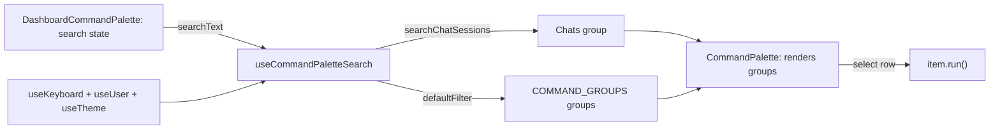
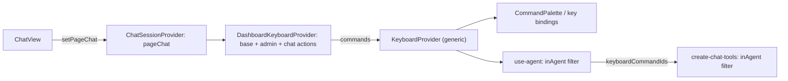

# RNT-85: Search chats from command palette

Make ⌘K a quick way to get back into a chat, shipped in two priority
slices: P0 chat search (RNT-85), P1 actions for the opened chat
(RNT-103).

## Branches

| Priority | Ticket  | Branch                                                        | Base      |
| -------- | ------- | ------------------------------------------------------------- | --------- |
| P0       | RNT-85  | `brandon-cercedo/rnt-85-search-chats-from-command-palette`    | `main`    |
| P1       | RNT-103 | `brandon-cercedo/rnt-103-add-chat-actions-to-command-palette` | P0 branch |

Merge order: P0 → P1. After P0 lands on `main`, retarget P1's PR to
`main`.

## Conventions

- No new search backend. Every chat (archived ones included) is already
  on the client in `useUser().user.chatSessions`, and
  `revalidatePath(..., "layout")` keeps it fresh.
- The palette is a generic shared component (`src/components/keyboard`).
  It only renders the `groups` it gets. The app layer owns the search
  text, the filtering and the group composition (mirrors the sidebar's
  `config.tsx`).
- Title search is a case-insensitive substring match, like
  `ChatArchivedDropdown`, not cmdk's fuzzy match.
- No React component tests.

## Checklist

### P0

- [x] Generic `CommandPalette`: `groups`, `searchText`, `onSearch`,
      `shouldFilter` props
- [x] `CommandPaletteItem.renderSuffixes` (extras such as the
      active-theme check mark)
- [x] `CommandPaletteGroup.limit` with a "Show N more" row
- [x] App hook `useCommandPaletteSearch` (incl. `searchChatSessions`)
- [x] `command-palette/DashboardCommandPalette` in the dashboard layout
- [x] Search helper and hook tests
- [x] `pnpm test:all` before the PR

### P1

- [x] `inAgent` flag; 6 chat commands in
      `COMMAND_IDS` and `BASE_KEYBOARD_COMMANDS`
- [x] Generic `KeyboardProvider` (`commands` prop, no `openHelp`)
- [x] `DashboardKeyboardProvider`: today's actions + admin and chat
      page actions
- [x] `pageChat` state in `useChatSession`, set by `ChatView`
- [x] Provider order in the dashboard layout
- [x] Agent filter in `use-agent.ts` and `create-chat-tools.ts`
- [x] Tests
- [x] `pnpm test:all` before the PR

---

## P0 — Search chats

### Behavior

- `Chats` is the first group, then `Agent`.
- **Empty search:** active chats with `lastMessageAt` in the last 7
  days, newest first.
- **While typing:** title matches across all chats. If the search text
  is part of the group name (`CHATS_GROUP`, e.g. "cha"), every chat
  matches. Active chats come first, then archived ones, each part
  newest first.
- **Limit:** the group shows **7** rows, then a "Show N more · M total"
  row that expands it. Expansion resets when the search text changes.
- **Icons:** archived rows use `LucideArchive`; active rows use
  `LucideMessageCircle` (as in the sidebar).
- **Selecting a row:** opens `/dashboard/chats/[id]`.
- **Empty case:** a group with no rows is hidden.

### Shared

- `src/components/keyboard/CommandPalette.tsx`:
  - Types: `CommandPaletteItem` (`id: string`, `value`, `label`,
    `keywords?`, `icon?`, `shortcut?`, `renderSuffixes?`, `run`) and
    `CommandPaletteGroup` (`id`, `heading`, `subHeading?`, `limit?`,
    `items`).
    `KeyboardCommand` plus `value` fits `CommandPaletteItem`, so
    `CommandId` stays strict for the agent tool.
  - Props: `groups`, `searchText`, `onSearch`, `shouldFilter` (default
    `true`; the dashboard passes `false`).
  - `shouldFilter={false}`: cmdk renders the groups exactly as given.
  - Each row renders icon, label, `renderSuffixes?.()`, then the shortcut
    keys. `value` is the item `value` (the hook sets it to the item
    `id`), so rows with the same title stay separate in cmdk.
  - `loop`: arrow keys wrap from the last row to the first and back.
- `src/components/keyboard/config.tsx`: export `Shortcut`. `Agent` is
  first in `COMMAND_GROUPS` (the keyboard help panel follows it).

### App (`src/app/dashboard/_components/command-palette/`)

- `hooks/use-command-palette-search.tsx`:
  - `searchChatSessions({ chats, searchText })` implements the chat
    behavior above (no limit; the group's `limit` handles that).
  - `CHATS_GROUP` (`"Chats"`) is the group heading and the name the
    search matches.
  - `useCommandPaletteSearch({ searchText })` reads commands, chats and
    theme, and returns `Chats` plus one group per `COMMAND_GROUPS` entry.
  - Commands: drop `inPalette: false`, then keep cmdk's fuzzy match with
    `defaultFilter(label, query, [...keywords, group])`. Score 0 is
    dropped, and the rest are sorted best match first.
  - The active theme command gets a check mark through `renderSuffixes`.
- `DashboardCommandPalette.tsx`: holds the search state and passes the
  hook's groups to `CommandPalette`. Future groups (e.g. RNT-86 tags) are
  added in the hook.
- `src/app/dashboard/layout.tsx` renders `DashboardCommandPalette`.

### Tests

- `command-palette/hooks/__tests__/search-chat-sessions.test.ts`:
  `searchChatSessions` (7-day window, active before archived,
  title match, group-name match, whitespace-only search).
- `command-palette/hooks/__tests__/use-command-palette-search.test.tsx`:
  group order, chat rows and icons, item `value` is its `id`, Chats
  `limit`, chat `run`, hidden
  commands, fuzzy match on label, keywords and group, best match first,
  active-theme check mark.

### Verification

- `pnpm lint`, `pnpm type:check`, `pnpm test`.
- Browser: empty ⌘K shows `Chats` then `Agent`. Typing matches titles,
  with archived rows after active ones, and other groups still filter.
  Selecting a row navigates and closes the palette.

---

## P1 — Actions for the opened chat (RNT-103)

### Behavior

- Chat actions show in the `Agent` group, before _New chat_, only while
  a chat is open on its own page.
- **Any chat:** _Move to sidebar_ (`PanelRight`), like
  `ChatOpenOffcanvasButton`: `openChat(pageChat.id)` opens the side panel
  and redirects to `/dashboard/chats`.
- **Active chat:** _Add to favorites_ (`LucideStar`) or _Remove from
  favorites_ (`LucideStarOff`), plus _Archive chat_ (`LucideArchive`).
- **Archived chat:** _Restore chat_ (`LucideRotateCcw`), plus _Delete
  chat_ (`LucideTrash2`).
- The `Agent` heading shows the opened chat's title next to it as a sub
  heading, truncated when long.
- They run from the client (the palette now, key bindings later), never
  from the agent.
- Toasts copy the chat buttons, including Archive's "Undo". _Delete
  chat_ opens the confirm modal with `ChatDeleteButton`'s copy; confirm
  deletes, closes the side panel chat and redirects to
  `/dashboard/chats`.

### Shared

- `src/components/keyboard/config.tsx`:
  - `inAgent?: boolean` on `BaseKeyboardCommand` (default `true`, like
    `inPalette`).
  - The 6 chat IDs in `COMMAND_IDS`, and their commands in
    `BASE_KEYBOARD_COMMANDS` before `new-chat`, with `inAgent: false`.
    One command list, no dashboard/marketing split.
  - Exempt from `max-lines`; the list keeps growing.
- `src/lib/keyboard.ts`: `getShortcutKeys`, `getKeyboardCommands` and
  `getShortcutCommands`, moved out of `config.tsx`.
- `src/hooks/use-keyboard.tsx`: `KeyboardProvider` takes a `commands`
  prop and owns only the maps, the ref and the key bindings. The action
  handlers and `openHelp` are gone; `UserMenu` runs the
  `open-keyboard-help` command.

### Feature (`src/features/chat`)

- `hooks/use-chat-session.tsx`: `pageChat` and `setPageChat`, kept apart
  from `chatId`/`openChat`/`closeChat` (the side panel). `openChat`
  checks `pageChat?.id` instead of the pathname, so the provider no
  longer uses `usePathname` and navigation doesn't re-render it.
- `hooks/use-agent.ts`: sends only commands with `inAgent !== false`.
- `services/tools/create-chat-tools.ts`: checks `inAgent` again, since
  client input can't be trusted.

### App (`src/app/dashboard`)

- `_components/keyboard/hooks/use-dashboard-keyboard.tsx`:
  - `DashboardKeyboardProvider` holds the dashboard actions moved from
    `use-keyboard.tsx`, plus `getAdminActions` (flag toolbar) and
    `getPageChatActions` (from `pageChat`). It builds the commands with
    `getKeyboardCommands` and renders `KeyboardProvider`.
  - `useDashboardKeyboard()` returns `useKeyboard()`.
- `chats/_components/ChatView.tsx`: sets `pageChat` in a layout effect
  that tracks only `chat`, and clears it on unmount. Before paint, so a
  click can't read an empty `pageChat`.
- `layout.tsx`: `ChatSessionProvider` → `DashboardKeyboardProvider` →
  `ChatInstancesProvider`.
- `use-command-palette-search.tsx`: the chat commands arrive through
  `useKeyboard().commands`. The hook sets the `Agent` group's
  `subHeading` to `pageChat?.title`.

### Tests

- `keyboard/hooks/__tests__/use-dashboard-keyboard.test.tsx`: throws
  outside the provider, dashboard actions, admin flag toolbar, chat
  commands per state (none, active, favourite, archived), _Move to
  sidebar_ calls `openChat`, and order before _New chat_.
- `command-palette/hooks/__tests__/use-command-palette-search.test.tsx`:
  the opened chat title is the `Agent` sub heading, and only there.
- `features/chat/hooks/__tests__/use-chat-session.test.tsx`: the
  current-page redirect in `openChat` is driven by `setPageChat`.
- `src/lib/__tests__/keyboard.test.ts`: the helpers, and the chat
  commands have `inAgent: false`.
- `use-keyboard.test.tsx`: commands passed in directly, key bindings and
  the palette guard.
- `services/__tests__/tools.test.ts`: chat commands are left out of the
  agent catalog.

### Verification

- `pnpm test:all`.
- Browser:
  - The chat actions show only on `/dashboard/chats/[id]`.
  - The `Agent` heading shows the chat title, truncated when long.
  - The favorite label flips after the chat refreshes.
  - _Move to sidebar_ opens the chat in the side panel and leaves its
    page.
  - Archiving shows the banner, and _Restore chat_ works.
  - _Delete chat_ confirms and redirects.
  - The agent can't list or run the chat commands.
- A chat can't be open on its own page and in the side panel at the same
  time: `openChat` redirects to `/dashboard/chats`.
