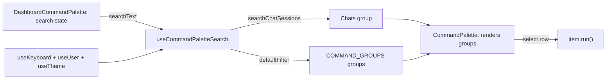

# RNT-85: Search chats from command palette

Make ⌘K a quick way to get back into a chat, shipped in two priority
slices: P0 chat search (RNT-85), P1 actions for the opened chat
(RNT-103).

## Branches

| Priority | Ticket  | Branch                                                        | Base      |
| -------- | ------- | ------------------------------------------------------------- | --------- |
| P0       | RNT-85  | `brandon-cercedo/rnt-85-search-chats-from-command-palette`    | `main`    |
| P1       | RNT-103 | `brandon-cercedo/rnt-103-add-chat-actions-to-command-palette` | P0 branch |

Merge order: P0 → P1. After P0 lands on `main`, retarget P1's PR to
`main`.

## Conventions

- No new search backend. Every chat (archived ones included) is already
  on the client in `useUser().user.chatSessions`, and
  `revalidatePath(..., "layout")` keeps it fresh.
- The palette is a generic shared component (`src/components/keyboard`).
  It only renders the `groups` it gets. The app layer owns the search
  text, the filtering and the group composition (mirrors the sidebar's
  `config.tsx`).
- Title search is a case-insensitive substring match, like
  `ChatArchivedDropdown`, not cmdk's fuzzy match.
- No React component tests.

## Checklist

### P0

- [x] Generic `CommandPalette`: `groups`, `searchText`, `onSearch`,
      `shouldFilter` props
- [x] `CommandPaletteItem.renderSuffixes` (extras such as the
      active-theme check mark)
- [x] `CommandPaletteGroup.limit` with a "Show N more" row
- [x] App hook `useCommandPaletteSearch` (incl. `searchChatSessions`)
- [x] `command-palette/DashboardCommandPalette` in the dashboard layout
- [x] Search helper and hook tests
- [x] `pnpm test:all` before the PR

### P1

- [ ] Chat command IDs in `COMMAND_IDS`
- [ ] Feature hook that builds the opened chat's commands
- [ ] `useCommandPaletteSearch` adds them to the `Agent` group
- [ ] Tests for the command set per state and the delete flow

---

## P0 — Search chats

### Behavior

- `Chats` is the first group, then `Agent`.
- **Empty search:** active chats with `lastMessageAt` in the last 7
  days, newest first.
- **While typing:** title matches across all chats. If the search text
  is part of the group name (`CHATS_GROUP`, e.g. "cha"), every chat
  matches. Active chats come first, then archived ones, each part
  newest first.
- **Limit:** the group shows **7** rows, then a "Show N more · M total"
  row that expands it. Expansion resets when the search text changes.
- **Icons:** archived rows use `LucideArchive`; active rows use
  `LucideMessageCircle` (as in the sidebar).
- **Selecting a row:** opens `/dashboard/chats/[id]`.
- **Empty case:** a group with no rows is hidden.

### Shared

- `src/components/keyboard/CommandPalette.tsx`:
  - Types: `CommandPaletteItem` (`id: string`, `value`, `label`,
    `keywords?`, `icon?`, `shortcut?`, `renderSuffixes?`, `run`) and
    `CommandPaletteGroup` (`id`, `heading`, `limit?`, `items`).
    `KeyboardCommand` plus `value` fits `CommandPaletteItem`, so
    `CommandId` stays strict for the agent tool.
  - Props: `groups`, `searchText`, `onSearch`, `shouldFilter` (default
    `true`; the dashboard passes `false`).
  - `shouldFilter={false}`: cmdk renders the groups exactly as given.
  - Each row renders icon, label, `renderSuffixes?.()`, then the shortcut
    keys. `value` is the item `value` (the hook sets it to the item
    `id`), so rows with the same title stay separate in cmdk.
  - `loop`: arrow keys wrap from the last row to the first and back.
- `src/components/keyboard/config.tsx`: export `Shortcut`. `Agent` is
  first in `COMMAND_GROUPS` (the keyboard help panel follows it).

### App (`src/app/dashboard/_components/command-palette/`)

- `hooks/use-command-palette-search.tsx`:
  - `searchChatSessions({ chats, searchText })` implements the chat
    behavior above (no limit; the group's `limit` handles that).
  - `CHATS_GROUP` (`"Chats"`) is the group heading and the name the
    search matches.
  - `useCommandPaletteSearch({ searchText })` reads commands, chats and
    theme, and returns `Chats` plus one group per `COMMAND_GROUPS` entry.
  - Commands: drop `inPalette: false`, then keep cmdk's fuzzy match with
    `defaultFilter(label, query, [...keywords, group])`. Score 0 is
    dropped, and the rest are sorted best match first.
  - The active theme command gets a check mark through `renderSuffixes`.
- `DashboardCommandPalette.tsx`: holds the search state and passes the
  hook's groups to `CommandPalette`. Future groups (e.g. RNT-86 tags) are
  added in the hook.
- `src/app/dashboard/layout.tsx` renders `DashboardCommandPalette`.

### Tests

- `command-palette/hooks/__tests__/search-chat-sessions.test.ts`:
  `searchChatSessions` (7-day window, active before archived,
  title match, group-name match, whitespace-only search).
- `command-palette/hooks/__tests__/use-command-palette-search.test.tsx`:
  group order, chat rows and icons, item `value` is its `id`, Chats
  `limit`, chat `run`, hidden
  commands, fuzzy match on label, keywords and group, best match first,
  active-theme check mark.

### Verification

- `pnpm lint`, `pnpm type:check`, `pnpm test`.
- Browser: empty ⌘K shows `Chats` then `Agent`. Typing matches titles,
  with archived rows after active ones, and other groups still filter.
  Selecting a row navigates and closes the palette.

---

## P1 — Actions for the opened chat (RNT-103)

In the `Agent` group, shown only while a chat is open on its own page.

- **Active chat:** _Add to favorites_ (`LucideStar`) or _Remove from
  favorites_ (`LucideStarOff`), plus _Archive chat_ (`LucideArchive`).
- **Archived chat:** _Restore chat_ (`LucideRotateCcw`), plus _Delete
  chat_ (`LucideTrash2`).

### Changes

- `src/components/keyboard/config.tsx`: add `favorite-chat`,
  `unfavorite-chat`, `archive-chat`, `restore-chat`, `delete-chat` to
  `COMMAND_IDS`. They stay out of `BASE_KEYBOARD_COMMANDS` and
  `KeyboardProvider`, so the agent's `runKeyboardCommand` tool can't
  trigger them.
- Chat feature hook (e.g. `useOpenedChatCommands`) returns
  `KeyboardCommand[]` for the opened chat:
  - Open chat: `chatSessions.find(c => pathname === paths.dashboard.chat(c.id))`.
  - With no open chat, it returns `[]`.
  - Handlers copy the existing button toasts and call
    `toggleFavoriteChatSession`, `toggleArchivedChatSession` and
    `handleDeleteChatSession`.
  - _Delete chat_ opens `useConfirmationModal` with `ChatDeleteButton`'s
    title, message and label. Confirm deletes, shows the toast, runs
    `closeChat(id)`, then `router.push(paths.dashboard.chats())`. No
    shared delete hook.
- `useCommandPaletteSearch` adds them to the `Agent` group.

### Tests

- Hook: command set per state (none off a chat page,
  favourite/unfavourite, archived), and the delete confirmation that
  deletes, closes and redirects.
- `useCommandPaletteSearch`: chat commands land in the `Agent` group.

### Verification

- Browser: the favourite label flips after revalidate, archiving turns
  on the banner, and _Restore chat_ works. _Delete chat_ opens the
  confirm popup cleanly after the palette closes (watch for a Preline
  modal-to-modal glitch) and redirects. No chat actions show on
  `/dashboard` or `/dashboard/chats`.
