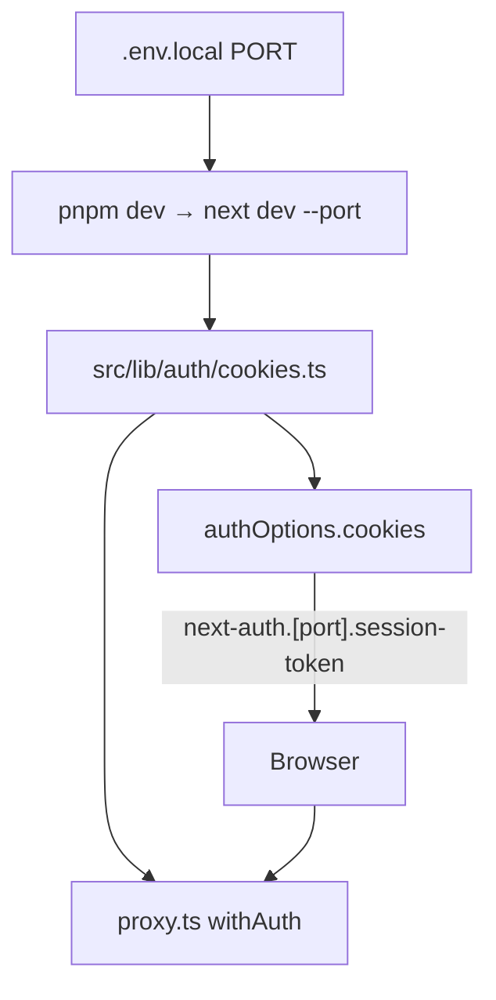

# Repo copies

High-level overview to run several copies of this repo.

## Overview

Settings to keep running repo copies (e.g. `root1`, `root2`, etc) at the same
time, each signed in, in one browser.

- Each copy runs its own dev server on its own port:
  - `PORT` in `.env.local` per copy; `pnpm dev` passes it to `next dev --port`.
  - `NEXT_PUBLIC_BASE_URL` and `NEXTAUTH_URL` follow `PORT`.
- Two approaches to keep copies apart:
  - **Port in names (default):**
    - Keeps auth cookies apart (see [Cookie names](authentication.md#cookie-names)).
    - Nothing to set; it works out of the box in dev.
  - **Subdomain:**
    - Keeps every cookie apart.
    - Need to set a subdomain in `.env.local` (e.g. `3001.localhost`), then
      open the app at that subdomain:

      ```sh
      NEXT_PUBLIC_BASE_URL="http://${PORT}.localhost:${PORT}"
      ```

## Design choices

| Choice                 | Reason                                             |
| ---------------------- | -------------------------------------------------- |
| Port in cookie names   | Browsers scope cookies by host and ignore the port |
| Subdomains as optional | Subdomains split every cookie, flags included      |

## Flow

`pnpm dev` reads `PORT` from `.env.local` and starts Next on it. In
development, `src/lib/auth/cookies.ts` builds the per-port auth cookie names,
and both `authOptions` and `proxy.ts` use them:



Some relevant details:

- **Port:**
  - Without `PORT`, Next uses `3000`, or the next free port.
  - With `PORT` set, a port already in use makes `pnpm dev` fail instead of
    picking another one.
- **Cookie prefix:** over sufix due to a suffix (`session-token.3001`) would
  make NextAuth read another copy's cookie as a chunk of the same token and
  fail with `Invalid Compact JWE`.
- **Proxy:** `withAuth` doesn't read `authOptions`, so `proxy.ts` passes the
  session cookie name itself.

## Considerations

- **Shared cookies:** with port in names, only auth cookies stay apart; other
  cookies, such as flag overrides (`vercel-flag-overrides`), are shared
  between copies. Use subdomains to keep every cookie apart.
- **Database:** each copy must point `DATABASE_URL` to its own database to
  keep data apart.
